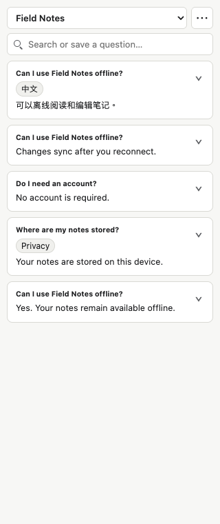
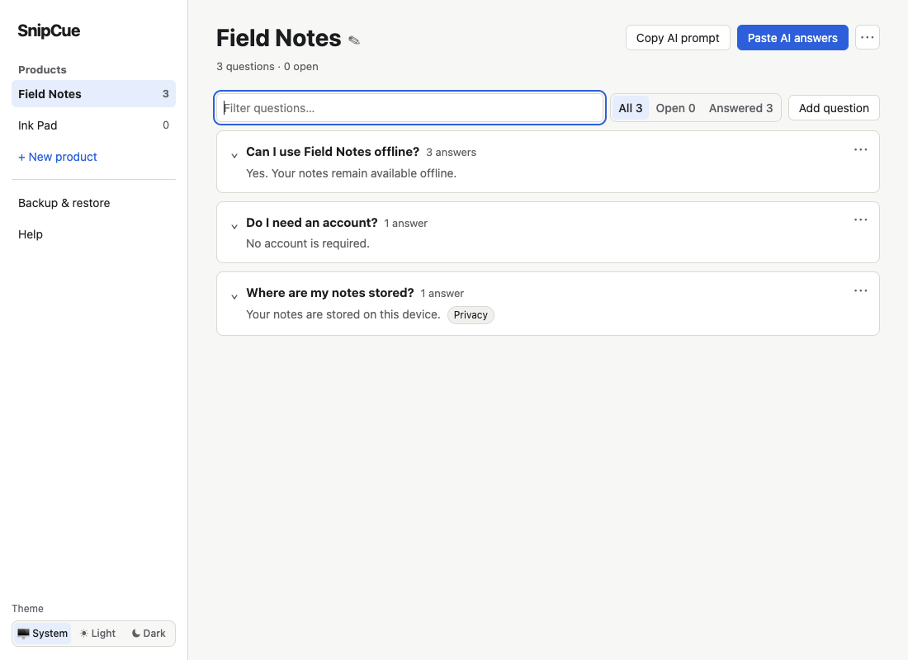

# SnipCue


**Stop retyping the same answers.** SnipCue is a Chrome extension that keeps the answers you give about your products — pricing, features, "do I need an account?" — and puts them one click away in the side panel while you reply on any website.

Your AI writes the answers; SnipCue stores, finds and copies them.

<p align="center">
  
  &nbsp;
  
</p>

## How it works

```
 notice a question ──▶ save it ──▶ ask your AI ──▶ paste the reply ──▶ copy it while browsing
   (any website)      (side panel     (Copy AI        (Paste AI           (click a card)
                       or right-click)  prompt)        answers)
```

- **Save questions as you see them.** Type in the side panel's search box: if nothing matches, press Enter to save it as an open question. Or select text on any page, right-click and choose **Save as question in SnipCue**.
- **Let your AI answer them.** **Copy AI prompt** gives any AI chat (ChatGPT, Claude, Gemini…) your open questions and a small JSON format. Paste the reply back with **Paste AI answers**, review it, and save.
- **Copy the right answer in one click.** Open the side panel, type a few letters, click a card. Answers you use most rise to the top.
- **Optional feed.** Point a product at a raw GitHub or Gist JSON file and SnipCue mirrors it, so an AI with access to your repo can maintain the answers for you.

Everything stays in your browser: no account, no server, no analytics, and SnipCue never reads the pages you visit.

## Install

SnipCue isn't on the Chrome Web Store yet. Install it from a release or build it yourself.

### From a release (no tools needed)

1. Download `snipcue-<version>.zip` from the [Releases](../../releases) page and unzip it.
2. Open `chrome://extensions` and turn on **Developer mode** (top right).
3. Click **Load unpacked** and choose the unzipped folder.
4. Pin SnipCue from the puzzle-piece menu so its button stays on the toolbar.

Keep the folder where it is: Chrome loads the extension from it. To update, replace the folder's contents with a newer release and click **Reload** on the SnipCue card.

### From source

Requires [Node.js](https://nodejs.org) 20 or newer and Chrome 116 or newer.

```sh
git clone <this repository's URL> snipcue
cd snipcue
npm install
npm run build
```

Then load `extension/dist` with **Load unpacked** as above. After pulling changes, run `npm run build` again and click **Reload** on the SnipCue card.

The development build adds the public key from `extension/dev-key.json`, so the unpacked extension keeps the same ID (`lbfmchoemeijlgoicpgngmoojfnacmln`) on every machine. That keeps your library in place across rebuilds.

## Using SnipCue

### 1. Add a product

Click the SnipCue toolbar button (or press **Alt+Shift+S**) to open the side panel, then choose **+ New product** from the product menu at the top. A product only needs a name.

You can manage everything in the library page: **⋯ → Open library** in the side panel.

### 2. Collect questions

- In the side panel, type the question into **Search or save a question…**. If no saved question matches, press **Enter** (or click **＋ Save … as a question**).
- On any page, select the question text, right-click, and choose **Save as question in SnipCue**. The toolbar icon shows **+1** when it's saved.

Saved questions without an answer are *open*. The **⋯** menu shows how many are waiting.

### 3. Get answers from your AI

1. **⋯ → Copy AI prompt** in the side panel (or **Copy AI prompt** on the product's library page).
2. Paste it into the AI chat where you discuss that product. The prompt lists your open questions first, the ones you've already answered so the AI doesn't repeat them, and the reply format.
3. Copy the AI's whole reply — commentary and code fences are fine.
4. **⋯ → Paste from AI** (or **Paste AI answers** in the library), paste, review the answers, and click **Save**.

If the reply has a mistake, SnipCue shows exactly what's wrong and a **Copy error for AI** button: paste that back into the chat and the AI corrects itself.

A question can have several answers with optional labels such as `Short`, `Formal` or `中文`. The format is documented in [docs/answer-import-format.md](docs/answer-import-format.md).

### 4. Use answers while browsing

Open the side panel next to the page you're replying on:

| Action | How |
|---|---|
| Find an answer | Start typing — questions, labels and answer text are all searched, including Chinese and Japanese |
| Copy it | Click the card (**Copied ✓**), or use **↓ / ↑** and **Enter** |
| Read a long answer | Click the **⌄** on the card |
| Switch product | Product menu at the top; **All products** searches everything |
| Clear the search | **Escape** |

Paste into the page and review before sending — SnipCue never posts anything for you.

### 5. Edit and organize

In the library, click an answer's **Edit** to change it; edits save automatically. Use **All / Open / Answered** to filter questions, and the **⋯** menus to rename or delete. Deleting can be undone for a few seconds.

### Product feeds (optional)

Keep a product's answers in a JSON file, for example in a GitHub repository, and let SnipCue follow it:

1. Create the file in the [feed format](docs/feed-format.md) (the same format as AI replies).
2. In the library, open the product's **⋯ → Feed settings…**, paste the file's raw URL (e.g. `https://raw.githubusercontent.com/<you>/<repo>/main/<product>.json` or a secret Gist's raw link), and click **Test & save**.
3. SnipCue refreshes the feed when you open the side panel or switch to that product (at most every five minutes), or immediately with **↻**.

The feed is the source of truth: answers from it are read-only in SnipCue, and your open questions are kept until the feed answers them. For a feed product, **Copy AI prompt** asks your AI to update the file, which works well with coding assistants that can edit and push to your repo. Anything in a public repository is public; private repositories aren't supported.

### Backup

Your library lives only in this Chrome profile. Use **Backup & restore** in the library to download a JSON backup, and import it on another computer or profile. Importing adds what's missing and skips answers you already have. The library reminds you if you haven't exported in 30 days.

### Settings

- **Theme:** System, Light or Dark, at the bottom of the library sidebar or in the side panel's **⋯** menu.
- **Shortcut:** change **Alt+Shift+S** at `chrome://extensions/shortcuts`.

## Privacy

SnipCue stores your library locally with IndexedDB and has no server, account or analytics. It asks Chrome for only `sidePanel`, `storage`, `unlimitedStorage` and `contextMenus`, so it cannot read the websites you visit. It receives selected text only when you choose its menu item, and it contacts the network only to fetch feed URLs you add. Details: [docs/PRIVACY.md](docs/PRIVACY.md).

## Development

```
extension/
  src/core/        data model, IndexedDB, search, AI paste parsing, backup, feeds
  src/background/  service worker: side panel and the right-click menu
  src/sidepanel/   the side panel (React)
  src/library/     the library page (React)
  src/ui/          shared components and hooks
  static/          manifest, HTML, CSS, icons
  scripts/         build, icon rendering, dev key generation
  test/            unit tests (Vitest) and a browser smoke test (Puppeteer)
design/logos/      logo concepts
docs/              formats, privacy policy, screenshots
```

| Command | What it does |
|---|---|
| `npm run build` | Development build into `extension/dist` |
| `npm run typecheck` | TypeScript check |
| `npm test` | Unit tests (Vitest with an in-memory IndexedDB) |
| `npm run test:browser -w extension` | Builds, loads the extension into a real headless Chrome and runs the end-to-end smoke test; screenshots go to the folder it prints. Set `CHROME_PATH` if Chrome isn't in `/Applications`. |
| `npm run build:store -w extension` | Minified build without the dev key, zipped as `extension/snipcue-<version>.zip` |

Pull requests are welcome. Please run `npm run typecheck`, `npm test` and, for UI changes, the browser test before opening one.

## Releasing

1. Update `version` in `extension/package.json` (the build copies it into the manifest) and add an entry to [CHANGELOG.md](CHANGELOG.md).
2. Commit, then tag and push: `git tag v0.1.0 && git push origin main --tags`.
3. The **Release** workflow checks that the tag matches the version, runs the tests, builds `snipcue-<version>.zip` and publishes a GitHub release with it attached.

Chrome Web Store listing copy and permission justifications are in [CHROMEWEBSTORE.md](CHROMEWEBSTORE.md).

## License

[MIT](LICENSE)
